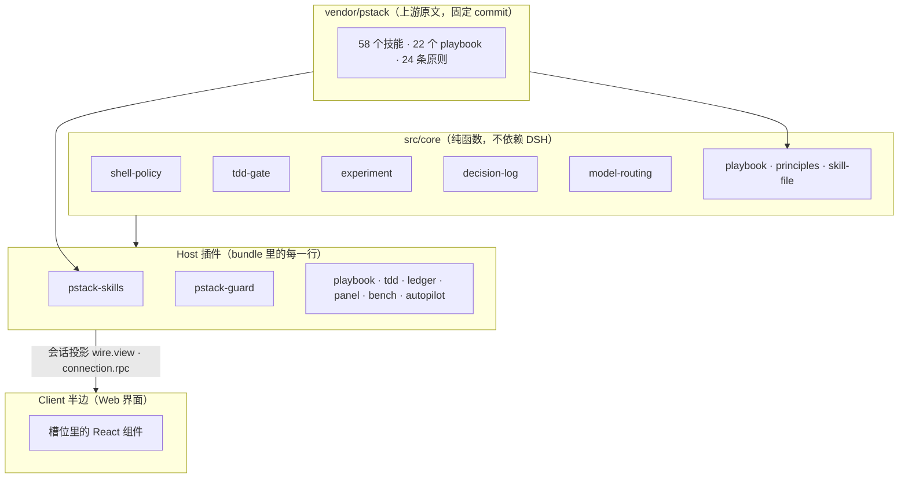
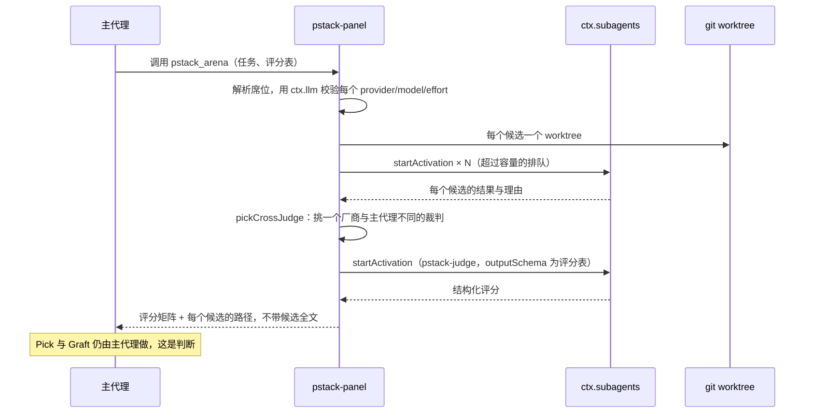
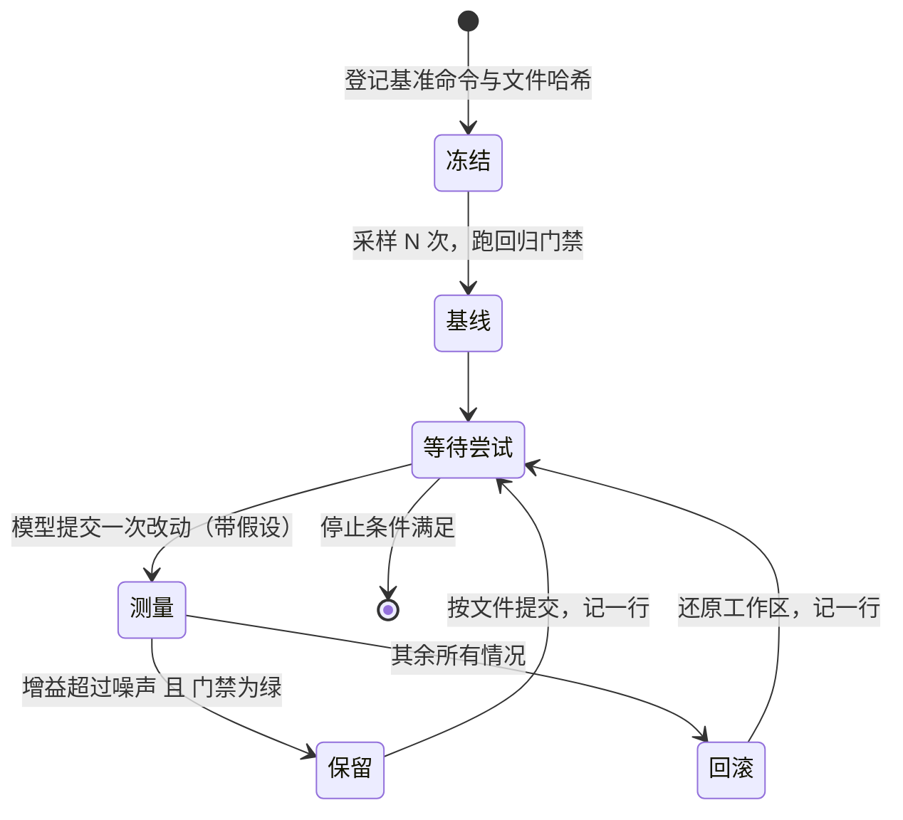

# 架构

## 三层

- **`vendor/pstack`** 是上游技能的原文，由 [`scripts/sync-pstack.mjs`](../scripts/sync-pstack.mjs) 按 commit 拷入，不手改。上游更新后重跑脚本，解析器测试会指出哪里的格式变了。
- **`src/core`** 把 pstack 的规则写成纯函数。它不引入任何 DSH 包，所以测试不需要启动 harness，也能原样用在别的 harness 上（比如以后的 Pi 扩展）。
- **Host 插件** 只做接线：把内核的判定接到 DSH 的扩展点上。每个插件是 bundle 补丁里的一行，可单独启停。
- **Client 半边** 只负责显示。状态由 Host 算好再推过来，客户端不自己折叠会话事件。

## 插件行

| 行 id | 入口 | 依赖的服务 | 做什么 | 里程碑 |
|---|---|---|---|---|
| `pstack-skills` | `./skills` | `skills` | 把 vendored 技能注册为技能提供者 | M0，已实现 |
| `pstack-guard` | `./guard` | `tools` | shell 命令的否决与审批 | M0，已实现 |
| `pstack` | `.` | `sessionProjections` | 根行。承载客户端半边，登记 Agent Preset 和 DSH 适配提示 | M1 |
| `pstack-playbook` | `./playbook` | `agents`、`commands`、`sessionProjections` | 识别当前 playbook，写入步骤，按 playbook 收紧工具面 | M1 |
| `pstack-tdd` | `./tdd` | `tools`、`commands` | TDD 门禁 | M1 |
| `pstack-ledger` | `./ledger` | `storageDomain`、`agents` | 决策日志、原则引用审计 | M1 |
| `pstack-panel` | `./panel` | `subagents`、`llm`、`subprocess`、`shell` | arena、interrogate、swarm 的编排 | M2 |
| `pstack-bench` | `./bench` | `jobs`、`shell`、`storageDomain` | hillclimb 实验台 | M3 |
| `pstack-autopilot` | `./autopilot` | `schedule`、`goals`、`subagents` | 无人值守运行与巡检 | M4 |

DSH 只把客户端半边挂到名字等于裸包名的那一行上，子路径行不带客户端。所以界面必须由根行 `pstack` 承载，其余行通过投影给它供数。

## 状态放哪

DSH 的规则是“会话日志是唯一事实来源，插件内存只是缓存”。据此分三类：

| 状态 | 例子 | 存放 | 原因 |
|---|---|---|---|
| 能从日志推导的 | 当前 playbook、TDD 处于红还是绿、本会话读过哪些原则 | `ctx.sessionProjections` 投影 | 分叉、恢复、重放时自动重建，不用自己存 |
| 插件自己产生的 | arena 的候选与评分、hillclimb 的每次尝试、决策日志 | `ctx.storageDomain`，表按 `SessionId` 建键 | 不能写进会话日志：仓库外插件的自定义事件类型会让会话无法重新打开 |
| 用户可调的 | 受保护分支、发布命令正则、面板席位、厂商标注 | 各行的 `Config` | 用户在自己的补丁层里覆盖，升级不丢 |

投影声明 `wire.view` 后，算好的值会直接到达客户端组件的 `useProjection`。这是界面取数的主通道。客户端发起的操作（比如在面板里点“采用这个候选”）走 `connection.rpc`。

## Agent Preset

DSH 里子代理的工具面和系统提示不能在生成时指定，只能来自预先声明的 preset。pstack 的角色对应如下，全部在 M1 随根行登记：

| preset | 对应 pstack | 工具面 | 提示 |
|---|---|---|---|
| `poteto-agent` | `agents/poteto-agent.md` | 完整 | 开工前完整读 `poteto-mode/SKILL.md` 和 `worker.md` |
| `comment-sicko` | `agents/comment-sicko.md` | 只读 | 上游原文 |
| `pstack-adversary` | interrogate 的评审员 | 完整，限定在自己的 worktree | interrogate 的 brief 原文 |
| `pstack-judge` | arena 的 cross-judge | 只读 | 按评分表逐项打分，推荐 base |
| `pstack-worker` | swarm 的 worker | 完整 | 报告只能是 `PASS`、`ISSUES` 或 `BLOCKED` 加证据 |

只读角色靠 preset 里不挂写工具来保证，不靠提示词要求。

## 编排引擎（M2）

arena、interrogate、swarm 共用一套扇出代码，差别只在席位从哪来、结果怎么收。

几处取舍：

- **直接用 `ctx.subagents`，不用 `ctx.workflowEngine`。** 工作流引擎只接受一段 JavaScript 字符串，不能给单个子代理设推理强度、preset 或工作目录，而且在 Web 配置里被隔离在各 preset 内部，Host 层的插件拿不到。
- **自己排队。** 容量满时 `startActivation` 直接以 `ACTIVATION_LIMIT_REACHED` 拒绝。
- **worktree 自己管。** 通过 `ctx.subprocess` 运行 `git worktree add`，结束后 `git worktree remove`。两步都登记在 `ctx.effect` 上，插件卸载或会话中断时不留垃圾。
- **interrogate 的验证由插件跑。** 评审员交回的每条结论必须带命令。插件用 `ctx.shell` 在同一个 worktree 里重跑，只有输出确实显示失败的才交给主代理。被丢弃的只报数量和原因。
- **裁判挑不出来就明说。** 用户只配了一家厂商时，`pickCrossJudge` 返回 `no-other-vendor`，arena 跳过 Phase C 并在结果里写明，不会悄悄用同厂商模型顶替。

## 实验台（M3）

模型只能做两件事：提出假设并改代码，然后调用 `pstack_attempt`。采样、算数、判定、提交或回滚都是插件做。冻结期间对基准文件的写入由 guard 否决。判定规则在 [`experiment.ts`](../src/core/experiment.ts)，回滚原因是枚举：样本不足、基准报错、工作量变了、门禁变红、变差、在噪声内。

基准脚本输出一行 JSON：`{"value": 142, "errors": 0, "work": 5000}`。`work` 用来识破“跑得快是因为少干了活”。

## 无人值守（M4）

| pstack 的做法 | 插件里 |
|---|---|
| `/loop 1h` 定时醒来巡检 | `ctx.schedule` 定时把巡检提示投进主会话 |
| “define done, then drive to it without stopping” | `ctx.goals.create({ objective, maxGoalRounds })` |
| 检查子代理有没有卡死 | `ctx.interval` 轮询 `listDescendants`，比对最近一次提交时间 |
| benny：工单进来后复现并修复 | webhook 运行时把事件变成新会话。这是实验包，放最后做 |

## 已知约束

- **所有 DSH 接口都未稳定。** DSH 仓库自己写着 “Public APIs are pre-stable”。本仓库用 `engines.dsh` 声明支持范围，并用 [`pnpm run smoke`](../scripts/smoke-dsh.mjs) 对着真实 DSH 验证，升级 DSH 前先跑它。
- **Web 配置里的 preset 隔离。** `tool-todo`、`plan-mode`、`workflowEngine` 等挂在各 preset 内部，Host 层插件看不到。需要时用 `ctx.agentPresets.serviceFor(agent, name)`。写入 todo 列表要等这点验证过再定方案。
- **护栏防的是手滑。** 命令分类器看得懂 `bash -c`、`env`、`sudo` 这些包装，看不懂别名和脚本文件。它不是安全边界。
- **子代理的审批策略被固定为 `never`。** 子代理里触发 `ask` 的命令会被直接拒绝。对强推来说这是想要的结果。
